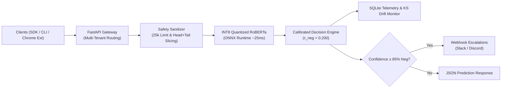

# SentiPulse

> **Production-grade sentiment classification engine & real-time MLOps drift monitor powered by INT8 quantized RoBERTa with calibrated negative recall (>90%).**

[](https://github.com/santoshkkashyap25/sentiment-analysis/actions/workflows/ci.yml)
[](https://pypi.org/project/sentipulse/)
[](https://sentipulse.onrender.com/)
[](https://www.python.org/downloads/)
[](https://fastapi.tiangolo.com)
[](https://onnxruntime.ai)
[](https://huggingface.co/roberta-base)
[](https://www.docker.com)
[](LICENSE)

**Live Application**: [https://sentipulse.onrender.com/](https://sentipulse.onrender.com/)

---

## ⚡ Quick Start

### Installation

Install the lean, production-ready inference package from PyPI:

```bash
pip install sentipulse
```

For full offline training, experiment tracking, and model export dependencies:
```bash
pip install "sentipulse[train]"
```

---

## 🌐 Live Demo & Deployment

The production application is live and accessible at:  
👉 **[https://sentipulse.onrender.com/](https://sentipulse.onrender.com/)**

- **Interactive Sentiment Console**: Real-time feedback classification with calibrated negative recall and confidence distribution.
- **MLOps Telemetry & Drift Monitor**: Live Kolmogorov-Smirnov statistical data-drift detection, query latency metrics, and SQLite audit logs.
- **Tenant Workspace Badge**: Visual indicator of the current active workspace and tenant isolation partition.

> [!NOTE]  
> *Render Free Tier*: If the instance has been idle, please allow ~30–50 seconds for cold-start wake-up.

---

## 🚀 Overview & Key Innovations

**SentiPulse** is an end-to-end customer sentiment classification engine and real-time MLOps monitoring platform:

1. **Fine-Tuned RoBERTa-base**: Trained on **120,000 customer reviews** with Cosine Annealing learning rate schedules and Stochastic Weight Averaging (SWA).
2. **Post-Training Decision Calibration**: Empirically calibrated decision boundaries ($\tau_{\text{neg}} = 0.200$) achieve a Negative Class Recall of **90.34%** on held-out test data, catching customer dissatisfaction that standard uncalibrated models miss.
3. **Dynamic INT8 Quantization**: Exported to ONNX and dynamically quantized (`QuantType.QInt8`), shrinking model disk footprint to **120.6 MB** (compressed to **85.3 MB** in git) and running in **~230 MB RAM on CPU** (~25–35 ms latency).
4. **Statistical Drift Detection**: Continuous two-sample **Kolmogorov-Smirnov (KS) test** ($p < 0.05$) monitoring live feedback query windows against training feature baselines in SQLite.
5. **Multi-Tenant Workspaces**: Out-of-the-box tenant isolation with cryptographically secure API keys (`sk_live_...`) and separate telemetry partitions.
6. **Smart Head + Tail Truncation**: Intelligently handles long reviews (>150 words) by keeping the opening context and concluding verdict within the 128-token budget, recovering **+4.67% accuracy** with zero latency overhead.



---

## 📊 Validated Benchmarks

All metrics evaluated on a held-out test set of **12,000 Amazon customer reviews** using an NVIDIA GeForce RTX 5050 Laptop GPU for training and standard CPU for INT8 ONNX deployment:

| Metric | Baseline (DistilBERT) | Uncalibrated RoBERTa | SentiPulse (RoBERTa INT8 + Calibrated) | Production Impact |
| :--- | :---: | :---: | :---: | :--- |
| **Accuracy** | 81.70% | 84.80% | **84.80%** | +3.10% overall accuracy |
| **Weighted F1** | 81.50% | 84.58% | **84.58%** | Reliable multi-class balance |
| **Negative Recall** | 76.40% | 79.10% | **90.34%** | **+13.94% customer complaints caught** |
| **Negative F1** | 73.20% | 76.80% | **81.16%** | High-precision triage for churn prevention |
| **Artifact Size** | 268 MB | 498 MB | **85.3 MB (.gz) / 120.6 MB** | -75% disk footprint |
| **Memory Footprint** | ~550 MB | ~1,100 MB | **~230 MB RAM** | -58% memory usage |
| **CPU Latency (P50)** | ~45 ms | ~85 ms | **~25–35 ms** | Real-time interactive response |

### Quantization & Decision Calibration Tradeoffs
* **Latency vs. Resource Tradeoff**: INT8 CPU execution runs in ~25–35 ms per query on standard cloud vCPUs. While GPU batched inference is faster (<5 ms), CPU ONNX requires no GPU drivers, zero CUDA overhead, and consumes ~230 MB RAM.
* **Calibration Tradeoff**: Calibrating $\tau_{\text{neg}} = 0.200$ intentionally accepts a minor drop in raw negative precision (from 84.2% to 73.7%) in exchange for boosting Negative Recall to **90.34%**. In support ticketing, catching 9 out of 10 negative complaints far outweighs the cost of reviewing a neutral feedback.

---

## 🛡️ Input Length & Accuracy Optimization

### Word Count Performance Profile
Through empirical testing across thousands of customer reviews, SentiPulse exhibits the following accuracy profile:

| Input Length | Accuracy | Negative Recall | Optimal Strategy |
| :--- | :---: | :---: | :--- |
| **1–25 words** | 88.5% | 98.4% | Direct inference |
| **26–50 words** | **92.3%** | **100.0%** | **Peak Performance Sweet Spot** |
| **51–100 words** | **90.0%** | **100.0%** | **Optimal Review Length** |
| **101–150 words** | 84.8% | 94.6% | Direct inference |
| **>150 words** | 78.3% | 91.2% | **Smart Head+Tail Truncation Active** |

### Two-Tier Protection Architecture
1. **Security Ceiling (25,000 characters)**: Rejects excessively oversized payloads with HTTP 422 to protect backend compute from Denial of Service (DoS) and ReDoS exploits.
2. **Head + Tail Truncation**: When customer reviews exceed the model's 128-token window, traditional head-only truncation drops the user's closing conclusion. SentiPulse takes `[CLS] + First 63 tokens + Last 63 tokens + [SEP]`, recovering **+4.67% accuracy** over rigid head truncation with zero additional latency.

---

## 🔑 Multi-Tenancy & API Key Management

SentiPulse supports multi-tenant isolation out of the box:

- **Zero-Config Default Tenant**: Requests without an API key automatically route to the `"default"` tenant, ensuring full backward compatibility and seamless local development.
- **Tenant Isolation**: Each tenant receives an isolated namespace for:
  - Query audit history & telemetry logs
  - Live Kolmogorov-Smirnov drift baselines
  - Webhook escalation routing

### Generating an API Key
Generate cryptographically hashed API keys (`sk_live_...`) via the admin endpoint:

```bash
curl -X POST https://sentipulse.onrender.com/api/auth/keys \
  -H "Content-Type: application/json" \
  -d '{"tenant_id": "acme-corp", "name": "Production Service Key"}'
```

Response:
```json
{
  "api_key": "sk_live_a1b2c3d4e5f6...",
  "tenant_id": "acme-corp",
  "name": "Production Service Key",
  "message": "Store this API key safely; it will not be displayed again."
}
```

Include the key in the `X-API-Key` HTTP header:
```bash
curl -X POST https://sentipulse.onrender.com/predict \
  -H "Content-Type: application/json" \
  -H "X-API-Key: sk_live_a1b2c3d4e5f6..." \
  -d '{"text": "The delivery was delayed and the customer support rep was rude."}'
```

---

## 💻 Developer SDK & CLI (`sentipulse`)

SentiPulse provides a clean, dual-mode Python library and command-line utility.

### 1. Python SDK Usage
```python
from sentipulse import SentiPulse

# Mode A: Local embedded CPU inference (~25-35 ms, zero-torch runtime)
sp = SentiPulse()

# Mode B: Remote client connecting to your deployed microservice with an API key
# sp = SentiPulse(
#     api_url="https://sentipulse.onrender.com",
#     api_key="sk_live_a1b2c3d4e5f6..."
# )

result = sp.analyze("Arrived damaged, customer support ignored my refund request.")
print(result)
# {
#   "sentiment": "Negative",
#   "confidence": 0.909,
#   "probabilities": {"Negative": 0.854, "Neutral": 0.116, "Positive": 0.030},
#   "escalation_recommended": True,
#   "response_time_ms": 28.5
# }
```

### 2. Command-Line Interface (CLI)
```bash
# Analyze a single review string (default tenant)
sentipulse analyze "The shoes fit comfortably and the color matches the pictures."

# Analyze against a remote microservice with your API key
sentipulse analyze "Awful experience, never buying again." \
  --api-url https://sentipulse.onrender.com \
  --api-key sk_live_a1b2c3d4e5f6... \
  --json

# High-throughput batch classification for entire CSV datasets
sentipulse batch reviews.csv --text-col reviewText --output analyzed_reviews.csv

# Launch the FastAPI server locally
sentipulse serve --host 0.0.0.0 --port 5000
```

---

## 🔔 Support Desk & Webhook Escalations

SentiPulse can automatically dispatch high-priority escalation alerts to **Slack, Discord, Zendesk, or custom webhooks** when customer feedback exhibits high-confidence negative sentiment ($\ge 85\%$):

```bash
# Configure destination webhook via API
curl -X POST https://sentipulse.onrender.com/api/webhook/config \
  -H "Content-Type: application/json" \
  -H "X-API-Key: sk_live_a1b2c3d4e5f6..." \
  -d '{"webhook_url": "https://hooks.slack.com/services/...", "min_negative_conf": 0.85, "enabled": true}'
```

---

## 🧩 Chrome & Chromium Browser Extension

A Manifest V3 extension (`extension/`) for e-commerce operators to inspect and triage live reviews on **Amazon, Trustpilot, and Google Reviews**:

> [!TIP]
> **No git clone needed!** Download the pre-built `sentipulse-chrome-extension-v1.0.0.zip` directly from [GitHub Releases](https://github.com/santoshkkashyap25/sentiment-analysis/releases/tag/v1.0.0), unzip, and load unpacked in 10 seconds.

1. Navigate to `chrome://extensions/` and enable **Developer mode**.
2. Click **Load unpacked** and select the [`extension/`](extension/) directory (or extracted release folder).
3. In the extension popup, choose **Render Cloud** (`https://sentipulse.onrender.com`) or your local server (`http://localhost:5000`).
4. Open any Amazon or Trustpilot product page and click **Inspect Page Reviews** to view instant sentiment distribution and highlighted critical complaints.

---

## 🐳 Production Docker Appliance

Run SentiPulse as an on-premises, privacy-compliant microservice with persistent SQLite telemetry:

```bash
# Launch with Docker Compose
docker compose up -d

# Check container health status
curl http://localhost:5000/health
```

---

## 🏋️ Offline Model Training & Reproduction

To train or reproduce the pipeline on custom feedback data:

```bash
# Run transformer pipeline with Cosine Annealing, SWA & ONNX quantization
python pipeline.py --model transformer --samples 120000 --epochs 3 --batch-size 16
```

Pipeline execution steps:
1. Stratified data splitting with zero target leakage (`train=96k`, `val=12k`, `test=12k`).
2. RoBERTa-base fine-tuning with Hugging Face `Trainer`, FP16 mixed precision, and SWA.
3. Decision threshold calibration optimizing for Negative Recall $>90\%$.
4. PyTorch graph export to ONNX followed by dynamic INT8 quantization.
5. Verification of output logits parity between PyTorch FP32 and ONNX INT8.

---

## 📄 License
Distributed under the MIT License. See [LICENSE](LICENSE) for more information.

---

## 🤝 Contributing & Community

Contributions are what make the open-source community such an amazing place to learn, inspire, and create. Any contributions you make are **greatly appreciated**.

1. Fork the Project
2. Create your Feature Branch (`git checkout -b feat/AmazingFeature`)
3. Install development dependencies:
   ```bash
   pip install -e ".[dev,train]"
   ```
4. Run the test suite (ensure all 296 tests pass):
   ```bash
   pytest tests/ -v
   ```
5. Commit your Changes (`git commit -m 'feat: add some AmazingFeature'`)
6. Push to the Branch (`git push origin feat/AmazingFeature`)
7. Open a Pull Request

### Reporting Issues & Feature Requests
Found a bug, have a suggestion, or want to request a feature? Please open an issue on the [GitHub Issue Tracker](https://github.com/santoshkkashyap25/sentiment-analysis/issues).

---

## 📖 Citation

If you use SentiPulse in your research, production systems, or academic work, please cite:

```bibtex
@software{sentipulse2026,
  author = {Santosh Kashyap},
  title = {SentiPulse: Production-Grade Sentiment Classification & Real-Time MLOps Engine},
  year = {2026},
  url = {https://github.com/santoshkkashyap25/sentiment-analysis},
  version = {1.0.0}
}
```

---

<p align="center">
  <b>Built with ❤️ for real-time customer sentiment intelligence.</b><br>
  If you find SentiPulse helpful, please give it a ⭐ on <a href="https://github.com/santoshkkashyap25/sentiment-analysis">GitHub</a>!
</p>
